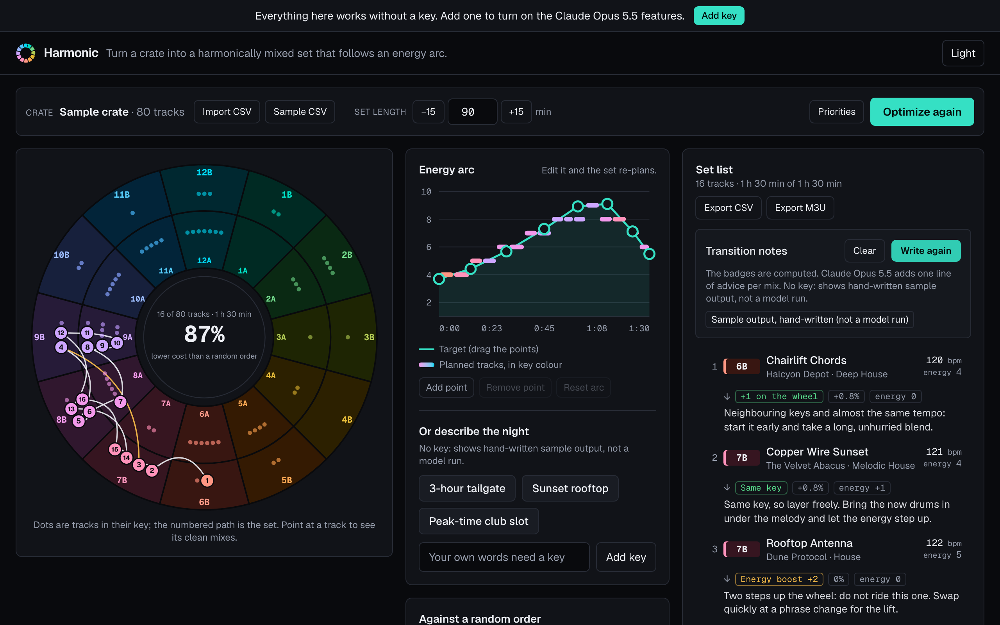
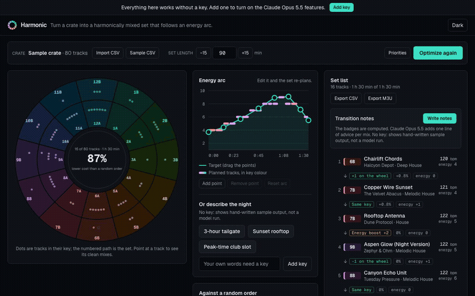
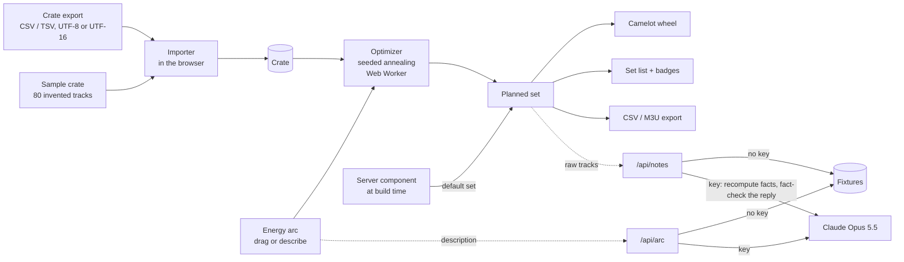
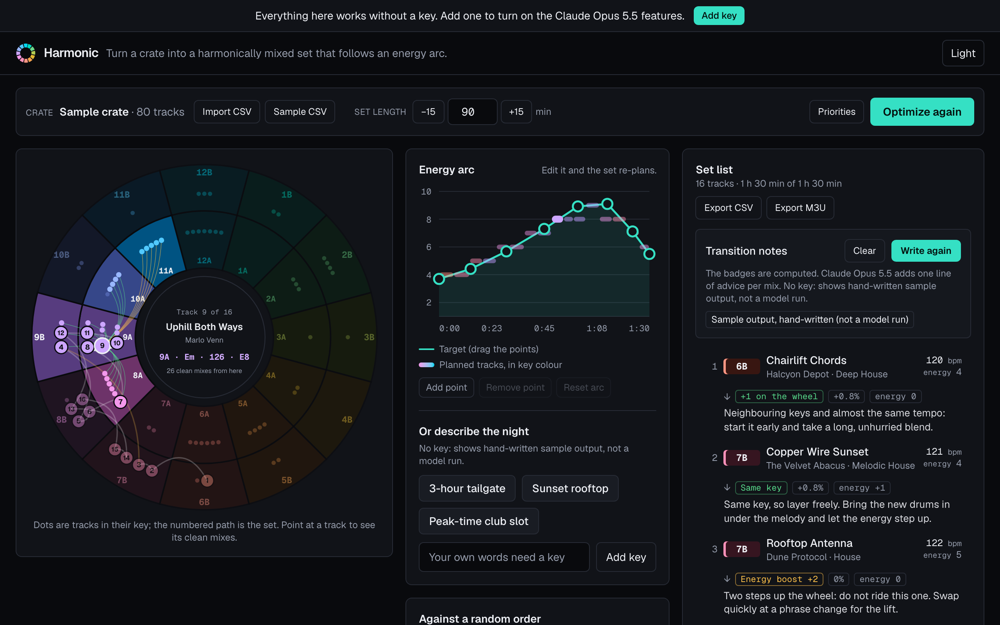
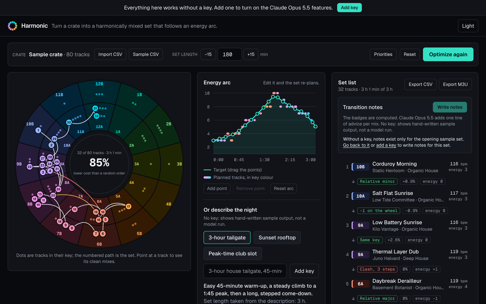
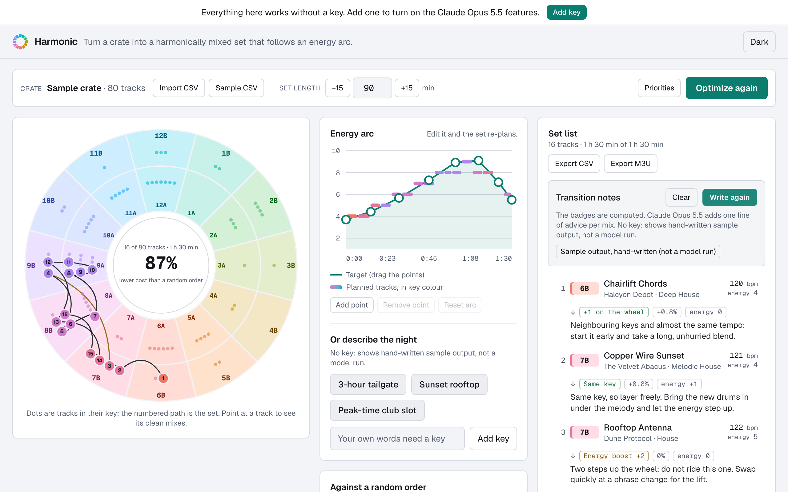
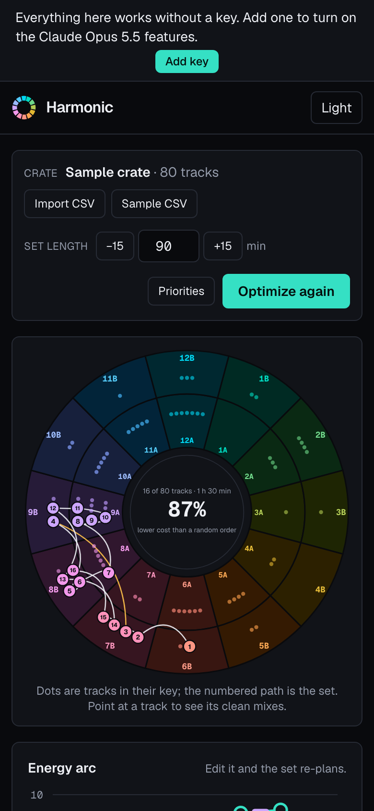
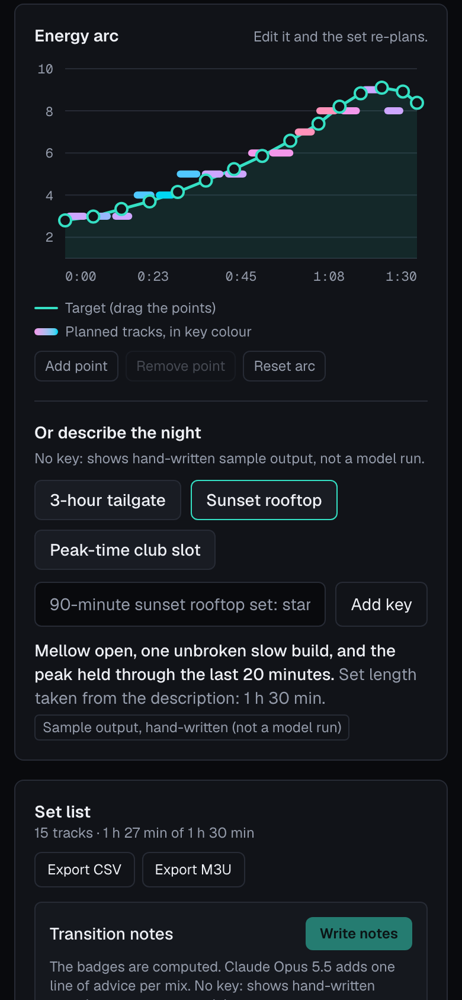

# Harmonic

> Turn a crate of tracks into a harmonically mixed DJ set that follows a planned energy arc.

[](https://github.com/davezagin-max/harmonic/actions/workflows/ci.yml)
[](LICENSE)
[](https://harmonic.vercel.app)



## Try it in 10 seconds

**[Open the live demo](https://harmonic.vercel.app)**: no key, no sign-up. It opens with an 80-track sample crate already planned into a 90-minute set. Click **3-hour tailgate** and watch the arc redraw and the set re-plan round the wheel, or drag any point on the energy arc. Point at a track on the wheel to see every clean mix out of it.

The optimizer, the wheel, the CSV import, and the exports need no key at all. The two Claude features (an arc from a description, and transition notes) answer their presets from fixtures in demo mode. Add your own Anthropic key in the app to run them live on your own words and your own set.

Demo data in this commit is hand-written sample output; `pnpm record` replaces it with real Claude Opus 5.5 runs.



## Why it's interesting

- **One search answers "which tracks" and "in what order".** The search state is a single ordering of the whole crate, and the set is the front of that ordering: tracks are taken in order until the target length is filled. Swapping a track near the front with one further back replaces it in the set, so simulated annealing (swap, insert, reverse moves, then a greedy pass) chooses and sequences at once. On the sample crate the optimized set costs 4.4 against 33.8 for the average of 200 random orders (87% lower, and well under the best random order at 20.1), with 15 of 15 mixes clean where a random order manages about 20%. A run takes about 20 ms on a laptop and happens in a Web Worker.
- **The same seed gives the same set in every JavaScript engine.** `Math.exp` and `Math.pow` are allowed to round differently between engines, which is enough to send a search down a different path. The annealing schedule and acceptance rule use only plain arithmetic, the random numbers come from a seeded generator, and a test fails if an engine-dependent math call creeps into the search. That is what lets the server plan the opening set at build time, so the first paint is already optimized, and lets the demo transition notes be written for exactly that set.
- **Code computes the facts; the model only phrases.** For transition notes the browser sends raw tracks, the server recomputes every key relation, tempo change, and energy change with the same tested functions the badges use, and Claude is asked only for one line of advice per mix. Each note is then fact-checked: if it quotes a BPM, a percentage, or a key that is not true for that mix, it is thrown away, asked for again once, and otherwise replaced by a rule-based note that is labelled as such.

## Architecture



| Path             | What lives there                                                                                           |
| ---------------- | ---------------------------------------------------------------------------------------------------------- |
| `lib/music/`     | Camelot rules, tempo cost, energy arc, the facts of one mix. Pure functions.                               |
| `lib/optimizer/` | Cost function, simulated annealing, random baseline, seeded generator, Web Worker entry.                   |
| `lib/crate/`     | Delimited-text reader, importer, sample crate, set timeline, CSV and M3U export.                           |
| `lib/ai/`        | `arc.ts` and `notes.ts` are the shared validators; `arc-live.ts` and `notes-live.ts` make the model calls. |
| `lib/ui/`        | Wheel geometry, key colours, and the wording for where AI output came from.                                |
| `components/`    | `Studio` holds the state; `CamelotWheel`, `ArcEditor`, `SetList`, `StatsCard`, `Toolbar`, `ArcPrompt`.     |
| `app/api/`       | `arc` and `notes` routes, both thin wrappers over the kit's `jsonRoute`.                                   |

## How it uses Claude Opus 5.5

| Feature                                                                                                                                                                                 | Why                                                                                                                                                                                                                                                                                                                                                                                                             |
| --------------------------------------------------------------------------------------------------------------------------------------------------------------------------------------- | --------------------------------------------------------------------------------------------------------------------------------------------------------------------------------------------------------------------------------------------------------------------------------------------------------------------------------------------------------------------------------------------------------------- |
| **Arc from words** (`POST /api/arc`): "3-hour house tailgate, 45-minute warm-up, peak at 1:45" becomes 12 to 24 curve points, a one-line summary, and the set length if one was stated. | Turning a loose description into a shape is judgement, which is what the model is good at. Structured output at `low` effort keeps it fast and cheap. The reply is validated before use: values clamped to range, points sorted and de-duplicated, the curve extended to both ends, and one corrective retry on the same conversation if there is no usable curve. Everything after the curve is deterministic. |
| **Transition notes** (`POST /api/notes`): one short line of mixing advice per mix.                                                                                                      | Advice is language; the numbers are not. The server recomputes the facts of each mix from the raw tracks and gives them to the model as data. A note that states a figure the facts do not support is rejected, and a follow-up on the same append-only conversation asks again for only those mixes. Anything still missing gets a rule-based note, tagged in the UI.                                          |
| **What Claude is not asked to do**: pick tracks, order them, score a mix, or compute any number.                                                                                        | Those have exact answers. They are computed by tested code, run without a key, and are the same every time.                                                                                                                                                                                                                                                                                                     |

Both calls go through one helper (`lib/claude.ts`) that always sends adaptive thinking with an explicit effort level, never forces a tool, reads content by block type, and treats a refusal as a normal result that the UI shows plainly. Text from the visitor (the description, and track and artist names from an imported file) is wrapped in tags and the system prompt says it is data, not instructions. Cancelling a request, or changing the set while notes are being written, aborts the call so no further model calls are made on the visitor's key.

**Your key stays yours.** The app is bring-your-own-key. The key lives in your browser tab's memory (optionally `sessionStorage`), travels in an `x-anthropic-key` header to this app's own API route, and is used for that one request. The server never stores or logs it. Each live action shows its token count and cost. Imported crate files are parsed in the browser and are never uploaded; a notes request sends only the title, artist, key, BPM, and energy of the tracks in the set.

## Run locally

```bash
pnpm install
pnpm dev
```

Open http://localhost:3170. It runs in demo mode until you add a key in the UI.

To try the importer, click **Sample CSV** to download the sample crate and see the simplest layout it reads. It also reads Rekordbox playlist exports (tab-separated, UTF-16), Serato and Traktor-style CSVs, and Mixed In Key exports; keys can be Camelot (`8A`), Open Key (`1m`), or musical (`Am`, `F#m`, `Bb`).

## Tests & quality

```bash
pnpm check   # lint, typecheck, unit tests, production build
```

184 tests, none of which need a key or a network:

- **Camelot rules**: every notation for all 24 keys, sharps and flats that name the same pitch, the 12-to-1 wrap, the four compatible moves, and clash costs that rise with distance round the wheel.
- **Tempo and energy**: the ±6% pitch range, half-time and double-time matches (87 against 174), arc interpolation, and the arc validator.
- **Optimizer**: beats the random baseline by a clear margin (under half the average cost and under the best of 200 shuffles), fills the target length to within half a track, never repeats a track, is identical for the same seed, stays close across seeds, responds to the priority weights, and finds the obvious answer on a six-track crate.
- **Import and export**: quoted commas, doubled quotes, byte-order marks, UTF-16 with and without a mark, five header layouts, skipped rows with reasons, derived energy, and exports that defuse spreadsheet formulas hidden in track titles.
- **Claude routes with a fake client**: request shape, untrusted-input wrapping, the retry on an append-only conversation, the fact check, the rule-based fallback, refusals, and no further calls after a cancel.
- **Fixtures**: every fixture passes the same validators as live output, `fixtures/presets.json` matches what the app sends, and placeholder flags are checked against each fixture's own value, so the suite stays green after real runs are recorded.
- **Smoke test**: the route handlers in demo mode, from an arc preset through a re-planned set to notes, plus the demo-miss, bad-input, and bad-key paths.

The UI was also walked in headless Chromium at 360, 390, 768, 1024, 1280, and 1440 px (no horizontal scroll before or after interacting), in both themes, and through the live path with every `/api` call intercepted. Screens from that pass:

| Point at a track: its clean mixes fan out                                                                                | "3-hour tailgate" preset: 32 tracks, clashes in red                                   |
| ------------------------------------------------------------------------------------------------------------------------ | ------------------------------------------------------------------------------------- |
|  |  |

| Light theme                    | Phone, first screen                          | Phone, arc from words                                |
| ------------------------------ | -------------------------------------------- | ---------------------------------------------------- |
|  |  |  |

CI runs the same checks plus a gitleaks secret scan on every push.

## Tradeoffs, limitations, next steps

- **The search is a heuristic, not a proof.** Annealing does not guarantee the best possible set. Different seeds give slightly different sets: on the sample crate every seed tested finishes below a fifth of the random-order average (a test bounds this), and **Optimize again** is there to show another good answer.
- **The data is only as good as the import.** Nothing here listens to audio. Key, BPM, and energy are whatever your DJ software wrote. When energy is missing, a stand-in is derived from where the track's tempo sits in the crate and is marked with `~`; treat the arc fit as approximate in that case.
- **The timeline is a simple model.** Each track is assumed to play for its length minus a 60-second blend. Real sets vary.
- **The harmonic rules are the standard ones, deliberately.** Same key, one step either way, relative major or minor, and the two-step energy boost are compatible; everything else is a graded clash, including diagonal moves that some DJs do use.
- **Demo notes cover one set.** Without a key, transition notes exist only for the opening sample set. Any other set needs a key.
- **Stopping a live call relies on the request's abort signal.** Cancel in the browser aborts the fetch, and the pipeline checks the signal before every model call; that path is tested with a fake client, not against a live connection.
- **Nothing is saved.** Reloading returns to the sample crate. Crates are capped at 500 tracks and notes at 60 tracks per set.
- **The sample crate is invented.** Titles and artists were made up for this project and have not been checked against a music catalogue, so a coincidence with a real name is possible.
- Rate limiting is in memory per server instance: enough to blunt abuse of a demo, not a global quota.
- **Next steps:** pin a track to a position ("open with this one"), avoid the same artist twice in a row, save the crate and plan locally, and read Rekordbox XML directly.

---

Built with Claude Code and Claude Opus 5.5.
